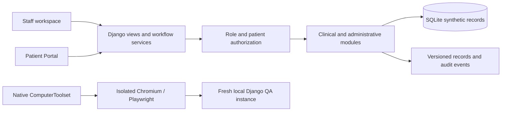

# CareFlow EHR

**An end-to-end synthetic EHR and hospital workflow platform, with a measured native AI browser evaluation.**

CareFlow connects patient registration, clinical documentation, nursing, diagnostics, pharmacy and hospital operations in one role-aware Django application. Built independently around common enterprise EHR workflows; not affiliated with Epic Systems.

*Actual v3 interface in an isolated synthetic environment. [Explore the product gallery](docs/showcase/portfolio/gallery.md).*

## Live Demo

### [Open Live Demo](https://jiawen.pythonanywhere.com/)

**[Staff Sign In](https://jiawen.pythonanywhere.com/login/) · [Patient Sign In](https://jiawen.pythonanywhere.com/portal/login/) · [Demo Accounts](#demo-accounts) · [Quick Walkthrough](#quick-walkthrough)**

The hosted Django website is online; its homepage and both sign-in routes returned HTTP 200 on November 16, 2026. No installation is required. Public shared staff credentials are **not yet available**. Explore the screenshots immediately, or optionally [create your own fictional patient account](https://jiawen.pythonanywhere.com/accounts/register/patient/). New patient accounts begin with their own chart; staff applications require approval.

> **DEMO — NOT FOR CLINICAL USE.** Fictional patients and simulated clinical/financial workflows only. Free hosting has capacity and renewal limits.

## Demo Accounts

**Public shared accounts are pending a separate safety/provisioning approval.** Existing operator and private demonstration passwords are not public demo credentials and are not disclosed here. The entries below are availability notices, not placeholder login credentials.

| Role | Demo Username | Demo Password | What to Explore |
| --- | --- | --- | --- |
| Physician | Unavailable | Not published | Charts, encounters, SOAP |
| Nurse | Unavailable | Not published | Worklist, vitals, flowsheets |
| Front Desk | Unavailable | Not published | Registration, scheduling, check-in |
| Patient | Unavailable | Not published | Appointments, released records, messages |
| Pharmacist | Unavailable | Not published | Verification, simulated dispensing |
| Laboratory Staff | Unavailable | Not published | Specimens, report publication |
| Administrator | Screenshot only | Never published | Role-aware dashboard and staff review |

No shared-account login or representative-data verification is claimed. A safe public account needs its own credentials, backend restrictions and an isolated data lifecycle. [Account availability and proposed safeguards](docs/showcase/portfolio/demo-access-plan.md).

## Quick Walkthrough

1. **Open the website** to see the unified staff/patient entry. No setup is required.
2. **Preview the staff journey:** [physician workspace and patient chart](docs/showcase/portfolio/gallery.md#physician-workspace-and-patient-chart).
3. **Follow the nursing and patient views:** [nursing worklist and Patient Portal](docs/showcase/portfolio/gallery.md#nursing-workspace-and-patient-portal).
4. **Try personal patient access, optionally:** register a fictional account, sign in through Patient Sign In, and inspect your own dashboard. This is a new-account experience, not a pre-populated shared clinical tour.
5. **Inspect the AI evaluation:** open a task's expected behavior, result JSON, screenshot and failure analysis below.

Already have private staff access from the owner? Use Staff Sign In. Public signup cannot grant Administrator access.

## Core Features

| Area | Implemented synthetic workflows |
| --- | --- |
| Patient access | Registration, demographics, MRN search, appointments and check-in |
| Physician care | Scoped worklists, encounters, medical history, diagnoses and signed SOAP notes |
| Nursing | Rooming assessments, vital signs, longitudinal flowsheets and MAR |
| Laboratory | Orders, specimens, results, corrections, withdrawals and revision-specific review |
| Medication and pharmacy | Orders, clarification, verification and simulated dispensing |
| Patient Portal | Released records, messages, appointment requests and patient-visible statements |
| Revenue cycle | Synthetic coverage, itemized statements, mock claims, payments and reversals |
| Imaging and hospital operations | Radiology reports, inpatient beds/transfers/discharge and ED tracking |

Backend role checks, patient/encounter scope, optimistic versions and audit events connect these workflows. There is no real prescribing, payment processing or clinical decision support.

## AI CUA Benchmark

**85 / 100 passed — 85% overall success rate**

| Evaluation | Recorded result |
| --- | --- |
| Model requested | GPT-5.4 |
| API / tool | OpenAI Responses API + native ComputerToolset |
| Evaluated tasks | 100: **85 passed, 15 failed** |
| Read-only / authorization | **69/70 — 98.57%** |
| Write / clinical workflows | **16/30 — 53.33%** |
| API responses recorded | 336 |
| Estimated token cost | **$3.38 — not a verified invoice** |

### Difficulty Breakdown

| Difficulty | Passed | Total | Success Rate |
| --- | ---: | ---: | ---: |
| Level 1 | 10 | 10 | 100% |
| Level 2 | 33 | 33 | 100% |
| Level 3 | 26 | 27 | 96.30% |
| Level 4 | 8 | 20 | 40% |
| Level 5 | 8 | 10 | 80% |

[All 100 Test Cases](docs/testing/cua100-v1/tasks.md) · [Per-Task Results](docs/testing/cua100-v1/results.md) · [Difficulty Breakdown](docs/testing/cua100-v1/results.md#difficulty-breakdown) · [Screenshots & Action Traces](docs/testing/cua100-v1/results.md#per-task-native-outcomes)

**What this measures.** The native execution path requests screenshot-driven computer actions from GPT-5.4. Playwright executes browser actions; the framework prepares synthetic data, performs applicable logins, positions the starting page and checks UI/database outcomes independently. It is not 100 wholly autonomous, zero-script end-to-end journeys. Separate offline rehearsals are not counted as native passes.

**Evidence limits.** Public artifacts contain 100 per-task records and 100 last-capture screenshots, but not complete raw API requests/responses or all intermediate captures. Requested model configuration is recorded; exact served model snapshots and billed charges are not independently verified. CF-032, CF-033 and CF-034 have source-hash provenance mismatches. The 85% rate applies to this benchmark only; it does not establish clinical readiness or production security.

[Full Audit & Evidence Limits](docs/showcase/portfolio/cua-evidence-audit.md) · [Failure Analysis](docs/testing/cua100-v1/findings.md) · [Evaluation Methodology](docs/testing/cua100-v1/README.md) · [Evidence Integrity Manifest](docs/testing/cua100-v1/evidence-sha256.json)

Consequential AI writes need human review: one synthetic task intended to reject a staff application instead approved it. Failed paid tasks were not retried; three initial zero-request startup blocks were fixed offline before first paid execution.

## Architecture & Tech Stack

| Layer | Technology / engineering focus |
| --- | --- |
| Application | Python, Django 5.2 modular monolith, server-rendered HTML/CSS |
| Persistence | SQLite, additive migrations, transactional workflow services |
| Access and integrity | Django sessions, CSRF, backend RBAC, scoped records, optimistic concurrency |
| Evaluation | OpenAI Python SDK 3.31.0, Responses computer tool, Playwright 1.61.0 / Chromium |
| Delivery | GitHub Issues, feature branches, PR review and GitHub Actions |
| Hosted demo | PythonAnywhere, WSGI, WhiteNoise, HTTPS |

For engineering review: inspect the workflow boundaries, independent verification assertions, audit history and openly reported AI failures. [Architecture](docs/architecture.md) · [Technical decisions](docs/decisions/) · [Hosted setup](docs/deployment/v3/README.md).

## Full Evaluation Evidence

- [Task contracts: Markdown](docs/testing/cua100-v1/tasks.md) / [JSON](docs/testing/cua100-v1/tasks.json)
- [Results with per-task evidence links](docs/testing/cua100-v1/results.md) / [CSV](docs/testing/cua100-v1/results.csv) / [JSON](docs/testing/cua100-v1/results.json)
- [100 native run records](docs/testing/cua100-v1/evidence/native/) / [100 last-capture screenshots](docs/testing/cua100-v1/evidence/screenshots/)
- [Preserved pre-API startup failures](docs/testing/cua100-v1/evidence/preflight/)
- [Deterministic rehearsal records](docs/testing/cua100-v1/offline-rehearsals.json)
- [Independent audit findings and provenance limits](docs/showcase/portfolio/cua-evidence-audit.md)
- [Executable harness at its evaluated revision](https://github.com/KateK77/careflow-ehr/tree/563b5b879e85ce664aecc3d9a3d78042191e52f4/tools/cua)

Recorded offline verification: **536 Django tests, 44 CUA harness tests and 100 task rehearsals passed**. These are distinct from native API results. CI executes Django checks/regression tests/migration consistency, not paid CUA testing.

## Development & Limitations

[Fresh local setup](docs/showcase/portfolio/development-status.md#local-setup) · [Current source, PR and deployment status](docs/showcase/portfolio/development-status.md) · [Iteration history](docs/iterations/) · [Original requirements](docs/requirements/)

The hosted v3 snapshot and the repository's default branch have different integration states; the linked status page names exact commits and open dependencies. Historical requirements, Chinese source documents, English translations and test evidence remain preserved.

This is an educational portfolio prototype, not a certified EHR. No exhaustive security, accessibility, concurrency or clinical validation is claimed. SQLite/free hosting constrain scale and availability; application audits are not administrator-proof database immutability. The native benchmark used fresh local fixtures, never existing clinical databases or public-host writes.
