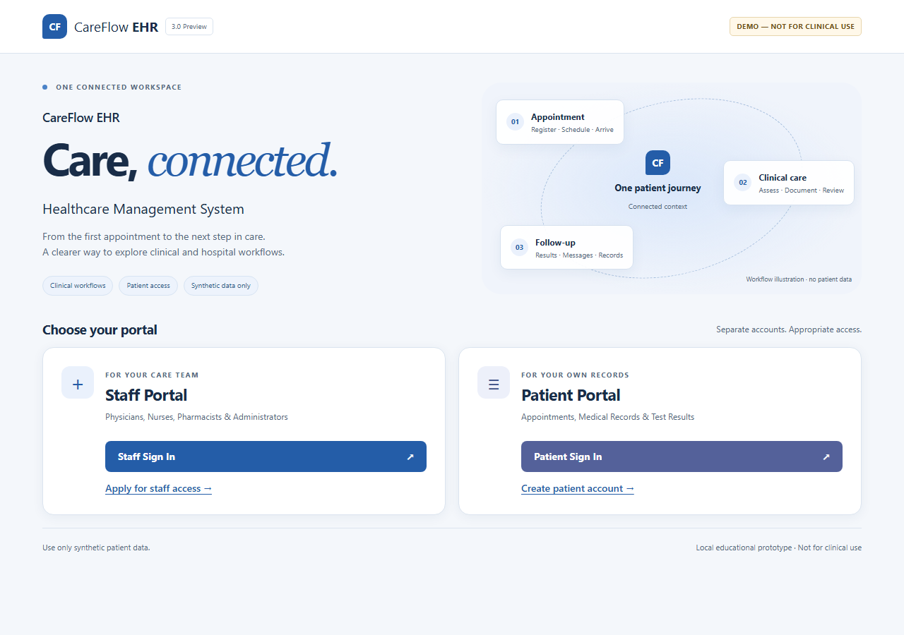
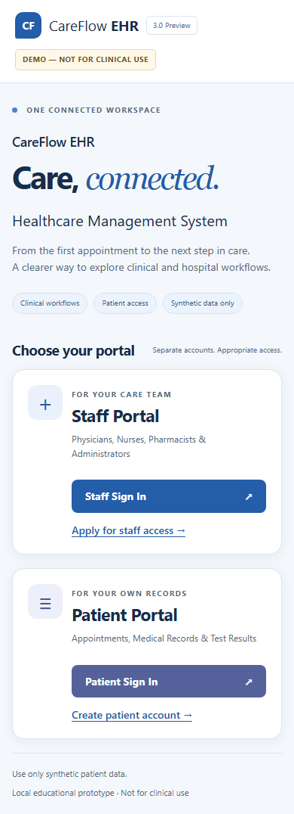
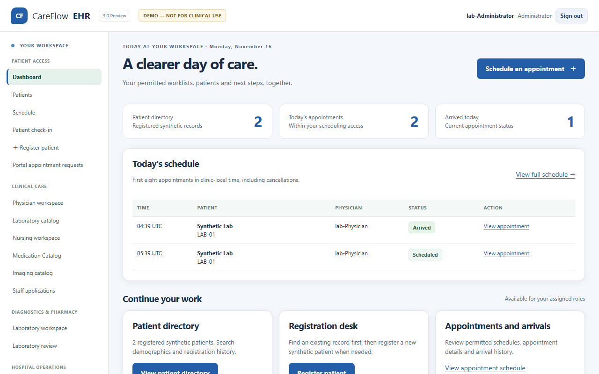
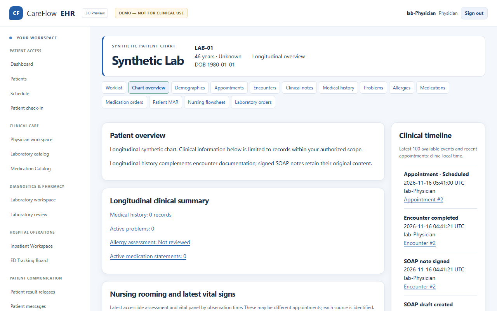

# CareFlow EHR · Care, connected.

**A working, synthetic-data EHR and hospital workflow prototype — from the first appointment to the next step in care.**

[Open the live demo](https://jiawen.pythonanywhere.com/) · [Staff sign in](https://jiawen.pythonanywhere.com/login/) · [Patient sign in](https://jiawen.pythonanywhere.com/portal/login/) · [Create a patient account](https://jiawen.pythonanywhere.com/accounts/register/patient/)



> **DEMO — NOT FOR CLINICAL USE.** Use fictional information only. CareFlow is independently developed and is not affiliated with Epic Systems or any EHR vendor. Clinical, medication, financial and hospital workflows are educational simulations.

## Try the application

No installation is needed. The free PythonAnywhere demonstration runs independently of the owner's computer.

**Patients:** choose **Create patient account**, enter a username, password and confirmation, explicitly confirm fictional-data use, then sign in through the Patient Portal. No email address is needed. Your account starts with a new fictional chart, not another visitor's records.

**Staff:** choose **Apply for staff access** and select a requested role. An Administrator must review and approve the application before staff sign-in is enabled. The same chosen password works after approval. Public signup cannot grant Administrator or superuser access.

**Operators:** use **Staff applications → Review application** to approve or reject with a role and reason. Pre-created demonstration credentials are handed privately to the owner, not published here. Unlike an unrestricted shared-admin sandbox, this site retains an owner-controlled approval boundary.

[Complete account and access guide](docs/user-guide/v3/README.md) · [Hosting verification](docs/iterations/0029-v3-email-access/public-deployment.md)

Free hosting has capacity limits and requires periodic renewal. Repository access does not imply access to staff functions. The public database contains basic fictional accounts and charts; historical local test patients were not uploaded.

## What is implemented

| Workspace | Working capabilities |
| --- | --- |
| Patient management | Registration, demographics, MRN search, duplicate warnings and auditable edits |
| Scheduling | Review/confirm appointment booking, physician calendars, conflict checks, cancellation and check-in |
| Physician | Scoped worklists, patient charts, encounters, SOAP drafts, explicit signing and completed encounters |
| Clinical history | Medical/surgical/family/social history, problems, allergies, medication statements and encounter diagnoses |
| Nursing | Rooming assessments, vital panels, flowsheets and clinical handoff |
| Laboratory | Catalog, orders, specimen collection, processing, publication, corrections, withdrawals and revision-specific review |
| Medication and pharmacy | Fictional orders, pharmacist claim/clarification/verification and simulated dispensing |
| MAR | Nursing administration events, holds, refusals, omissions and correction history |
| Patient Portal | Authorized released records, messaging, appointment requests and patient-visible statements |
| Billing | Synthetic coverage, itemized statements, mock claims, denial/appeal, payments and reversals |
| Imaging | Orders, scheduling, examination workflow, versioned reports and physician acknowledgement |
| Inpatient and ED | Bed allocation, admission, transfer/discharge, triage simulation, observation and ED-to-inpatient transitions |
| Access administration | Username-only patient signup and reviewed staff enrollment with backend role checks |

There is no real prescribing, dispensing, payment processing, external laboratory connection or automated medical advice.

## A look inside

The live entry page works at desktop and mobile sizes. Screenshots show the actual application, not a concept mockup.

<details>
<summary>Mobile portal entry</summary>



</details>

### Staff workspace and longitudinal chart

These screenshots come from isolated synthetic Chromium rehearsals, not live patient records or AI-generated mockups.





Separate portal sessions and server-side role/patient checks protect workflow boundaries. Sign out before switching roles, or use independent browser profiles.

## AI-driven browser evaluation: CUA-100

[Read all 100 tasks](docs/testing/cua100-v1/tasks.md) · [Machine-readable task contracts](docs/testing/cua100-v1/tasks.json) · [Method and results](docs/testing/cua100-v1/README.md)

This benchmark progresses from simple page entry and scoped record reading to access-denial probes, validated writes, signed SOAP documentation, laboratory publication and pharmacy handoffs. Each task gets a **new temporary synthetic database** and preserves a separate signed SOAP record.

The native path uses the official OpenAI Responses API `computer` tool and `ComputerToolset`. The model observes screenshots and chooses real mouse/keyboard actions. Deterministic Chromium rehearsals are reported separately and never counted as native AI passes.

Results distinguish **PASS, FAIL, BLOCKED and NOT_RUN**, retain first attempts, and report execution coverage and measured token-cost estimates. No unexecuted task is marked passed. See the results record for the exact tested commit, model, counts and limitations.

## Engineering and verification

- Python / Django 5.2 / SQLite; server-rendered HTML and CSS.
- Modular clinical and administrative domains, same-origin sessions and CSRF protection.
- Backend role/record authorization, optimistic version checks and transactional workflow services.
- Versioned clinical records, signed-note preservation and auditable events.
- Issue → branch → commit → PR → review workflow, CI, deterministic browser regression and separately tracked native CUA.

Latest application verification before this benchmark: **536 Django tests and 32 local Chromium workflows passed**. Public deployment verification: **9 Chromium checks passed**, with SQLite integrity and separate backup/restore checks. These are scoped results, not comprehensive security or clinical certification.

[Application evidence](docs/iterations/0029-v3-email-access/verification.md) · [Deployment evidence](docs/iterations/0029-v3-email-access/public-deployment.md) · [Architecture](docs/architecture.md) · [Development history](docs/iterations/)

## Run a fresh local demo

Use Python 3.13 and run from a checkout of this branch:

```powershell
python -m venv .venv
.\.venv\Scripts\python.exe -m pip install -r requirements.txt
.\.venv\Scripts\python.exe tools\v3_preview.py --port 8015
```

The launcher prompts privately for a synthetic password and allocates a **new** preview database. Open http://127.0.0.1:8015/. Never reset, reseed or migrate an existing local/preview database as a setup shortcut.

[Local setup and role usernames](docs/iterations/0029-v3-email-access/README.md) · [Hosted settings](docs/deployment/v3/README.md)

## Known limitations

- Educational synthetic prototype, not a certified EHR or production medical service.
- No email verification or email password recovery; operator-controlled staff approval is a demo workflow, not verified professional identity.
- SQLite and free single-worker hosting do not establish production concurrency or availability.
- Application-level audits do not imply database-administrator-proof immutability.
- No exhaustive security, accessibility, load or clinical validation.
- AI browser failures can result from task execution, harness limits or application behavior; the benchmark reports these separately.
- Native benchmark traffic targets isolated local fixtures, never the public demo or existing clinical databases.

## Version and source status

The v1.0 integration is preserved in main. This showcase includes the later v2/v3 interface and registration work on an unmerged branch. **Main remains the default branch**, as requested by the owner.

[Latest showcase branch](https://github.com/KateK77/careflow-ehr/tree/docs/public-showcase-cua100) · [V3 PR #61](https://github.com/KateK77/careflow-ehr/pull/61) · [Showcase and benchmark Issue #62](https://github.com/KateK77/careflow-ehr/issues/62)

No automatic merge, release tag or clinical deployment is implied. [Previous README snapshot](docs/showcase/v3/README.before-showcase.md) and original Chinese requirements, English translations and approved prompts remain preserved.
