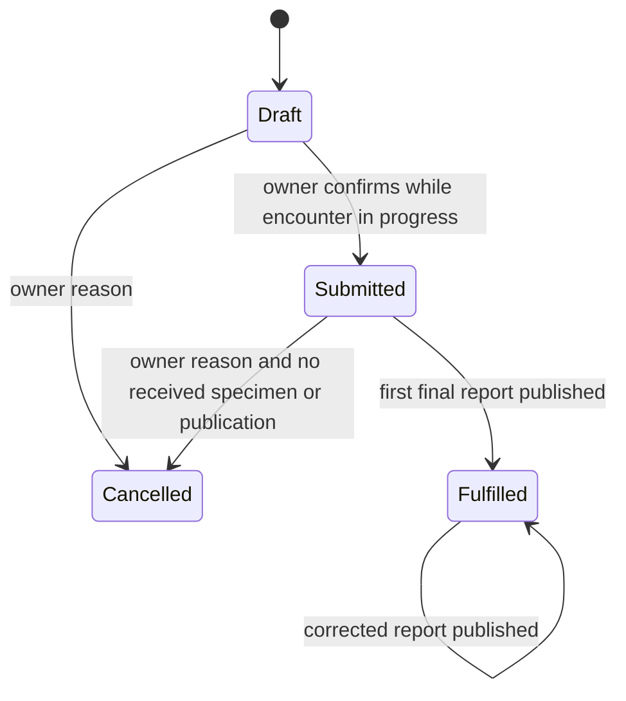
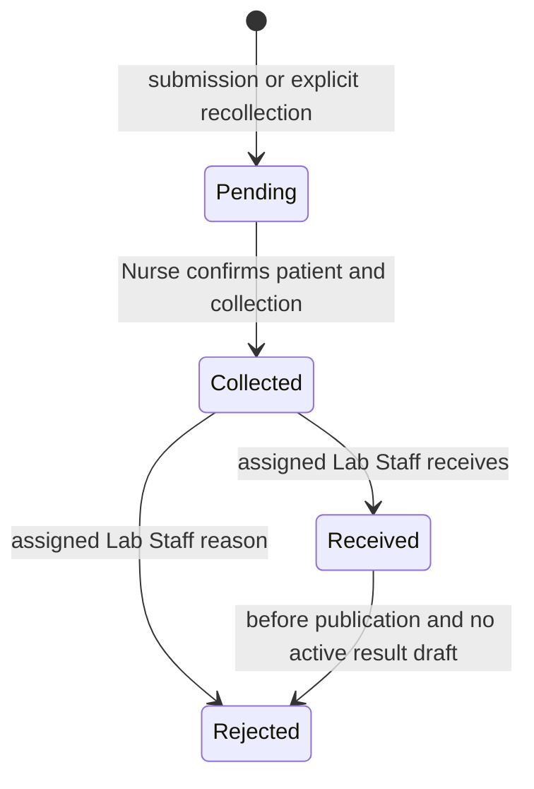
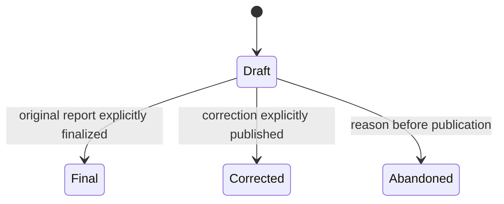
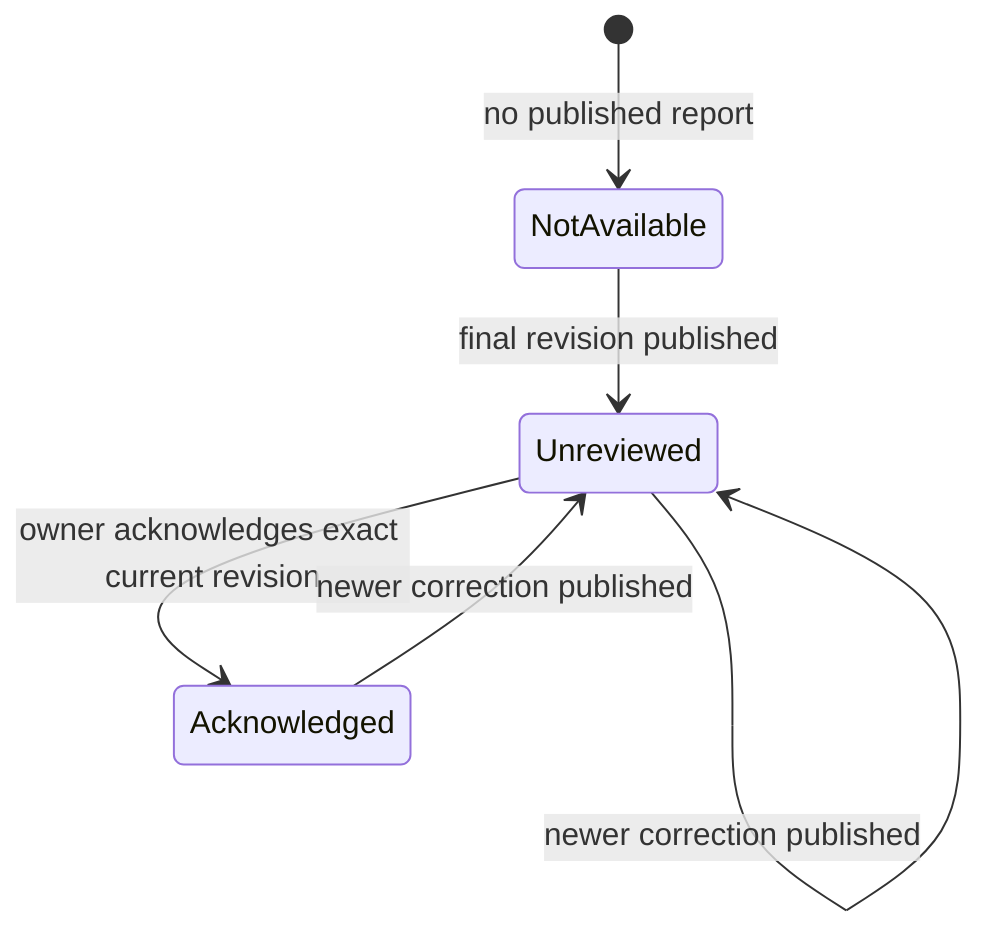

# State and transaction design v0.1

**Proposal only; implementation is not approved.** These four state axes are separate. A completed encounter is not a fulfilled order, a received specimen is not a final result, and a final result is not physician-acknowledged.

## Order

Cancelled is terminal. Submitted remains submitted during collection/rejection/draft processing; separate specimen/result badges communicate progress. Fulfilled does not require physician acknowledgement. Completion of the originating encounter does not change order state. Draft edit/submit is disabled after completion, but owner cancellation remains available. No automatic order submission/cancellation on encounter completion.

## Specimen attempt

Rejecting an attempt permits a new pending attempt under the submitted order. Preserve all rejected rows. Only one pending/collected/received attempt may exist. No result may be entered for rejected/unreceived specimens. A draft must be explicitly abandoned before rejection. No rejection after publication; that would need a separately approved error/withdrawal policy. Cancelling the order freezes further work but leaves actual specimen history intact.

## Result revision

Final/Corrected/Abandoned rows are immutable. To correct, create another Draft pointing to the current published revision; the previous report remains current until atomic publication. Publishing updates current_result and creates a linear chain. Superseded is a computed history label. No clinical preliminary status is published in this proposal.

## Physician review for current published revision

These are derived UI states, not an order-field state machine or deletion of old reviews. An existing acknowledgement stays on its old revision. A pending correction draft does not invalidate the currently published acknowledgement until the correction is published. If the ordering physician becomes inactive, show responsibility unresolved; never auto-acknowledge or silently reassign.

## Transition guards / race outcomes

| Race or operation | Required outcome |
| --- | --- |
| Submit versus encounter completion | Existing provider serialization is shared. Submit first creates the order before completion; completion first makes submission conflict. Completion's original signed-note requirement is unchanged. |
| Cancel versus receipt/collection | Current order version and common provider/order lock give one winner. Receipt first prevents cancellation; cancellation first denies collection/receipt. A collected-but-not-received order may still cancel and keeps its specimen row. |
| Reject versus finalize | Finalization requires received current specimen; publication first prohibits rejection. Rejection cannot race an active draft because explicit abandonment is required. |
| Two collection/recollection requests | Aggregate serialization, unique active attempt and durable command key prevent duplicate specimens. |
| Two Lab Staff claims/reassignment | One current assignee; stale claimant/previous assignee fails current actor/version checks before any write. |
| Two draft saves or corrections | One current draft plus expected edit/aggregate versions. Never last-write-wins; stale input remains visible with HTTP 409. |
| Two finalizations | Atomic publication, current draft version, unique published-successor constraint and command receipt yield one report/event. Exact command replay returns existing outcome. |
| Acknowledge versus correction publication | If acknowledgement commits first, it covers the previous report and the later correction is unreviewed. Correction first rejects the old revision's acknowledgement. |
| Completed encounter with submitted order | Collection, receipt, publication/correction and acknowledgement continue by their lab-specific guards. Encounter status/time/version, appointment provenance and signed SOAP remain unchanged. |

## Idempotent command protocol

Generate a UUID per rendered mutating form and retain it when validation/conflict redisplays input. Bind it to authenticated actor, action, target context, expected versions and canonical payload fingerprint. Authorize actor/context before checking or disclosing a receipt. Under the transaction, exact successful replay returns the existing record/outcome with a replay notice; same UUID/different payload or context is 409. Failed validation/rollback stores no success receipt, so corrected input can be resubmitted with a new command UUID. A legitimate new review/order uses a fresh key and still satisfies domain uniqueness/repeat-test rules.

Client double-submit protection is convenience only. Durable unique command events, order creation key, aggregate versions and DB constraints are authoritative across tabs/processes. Do not count a replay as another clinical event. An already acknowledged revision with a new key returns a friendly conflict rather than another acknowledgement.
