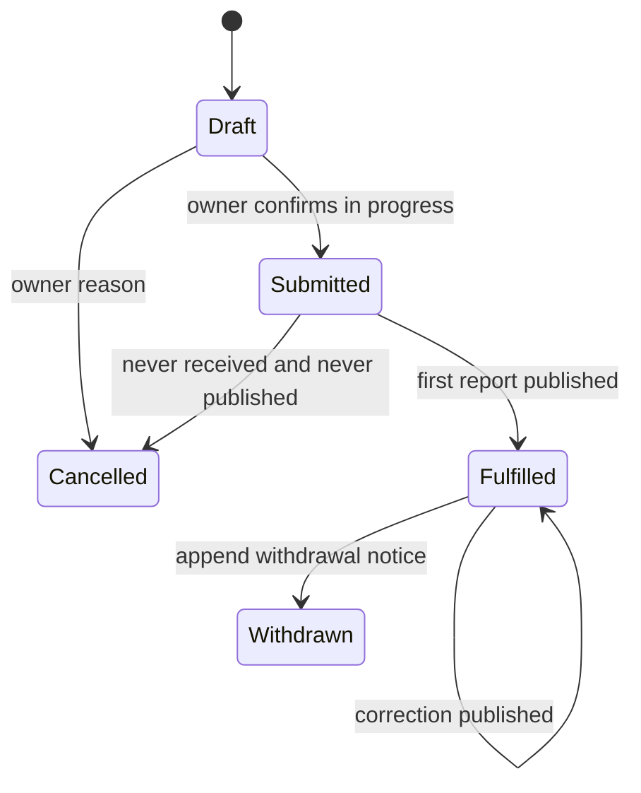
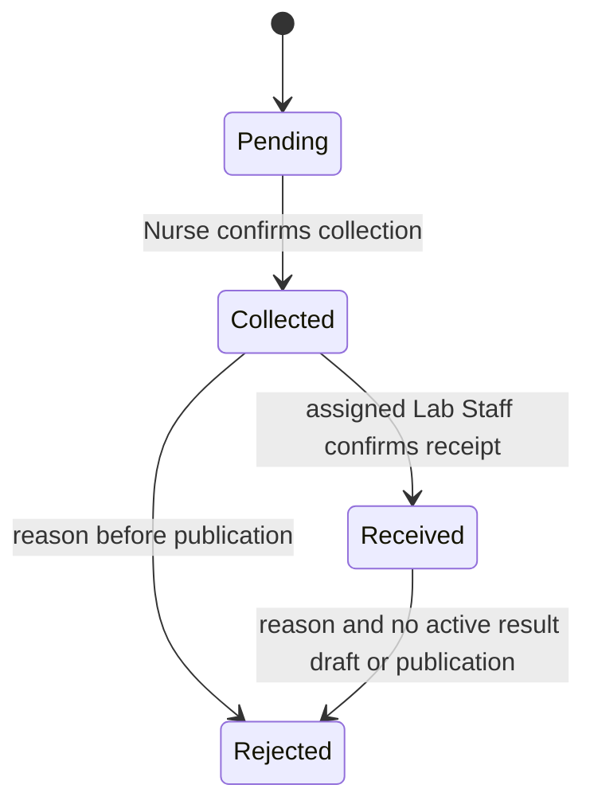
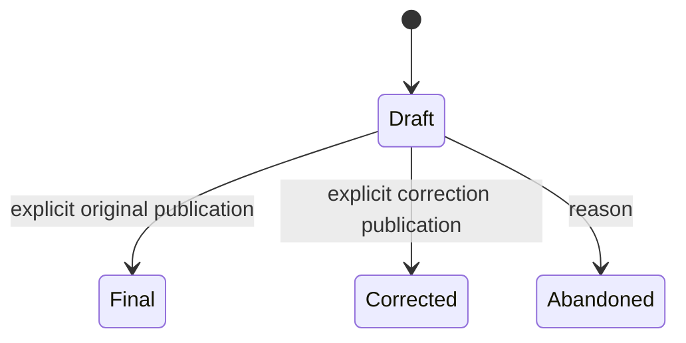
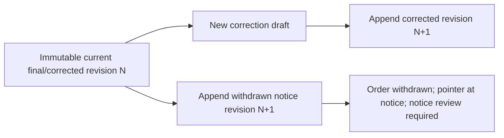
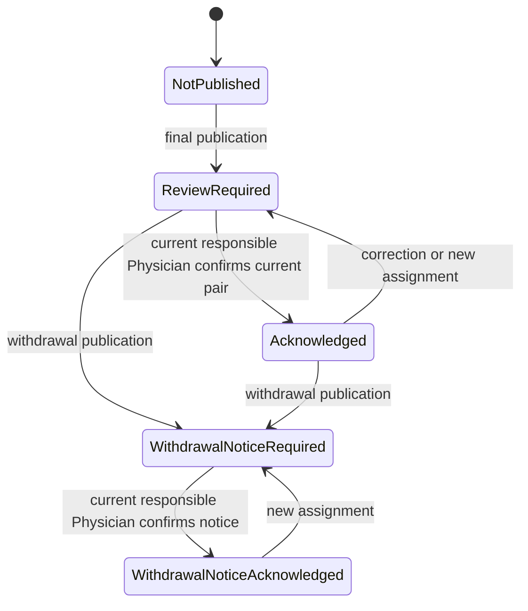

# Revised state machines and races v0.2

**Design proposal; implementation is not approved.** The four state axes remain independent. Current review responsibility is additionally identified by an immutable assignment epoch. Published records are never edited to change their past state.

## Order

Cancelled and Withdrawn are terminal for lab processing. Review assignment/notice acknowledgement may still change after withdrawal. First fulfilled_at remains historical. Current publication remains the withdrawal notice, not NULL or an earlier report. Encounter completion changes none of these states or existing lab review duties.

## Specimen attempt

Recollection creates a new Pending attempt; no Rejected→Pending transition. One non-rejected row exists per order. Once any received_at exists it is retained even after rejection, permanently closing cancellation. Cancelled/fulfilled/withdrawn orders permit no specimen writes. After encounter completion, still-submitted orders permit collection, rejection and recollection. Publication freezes specimen history for that order; withdrawal does not reset it.

## Report publication chain

Each node above represents one immutable outcome of a report draft. To correct Final/Corrected, create a **new** Draft. To withdraw current Final/Corrected, directly append a **new** immutable Withdrawn notice revision referencing it; there is no mutation of the old report to Withdrawn. All published predecessor/successor history remains. A withdrawal requires no active correction draft; abandon it explicitly first. After a withdrawal there is no new report draft, correction, restore or silent fallback on that order.

The arrows above mean append a successor, not mutate or erase revision N. Only one branch may publish against a given current predecessor; an existing correction draft must be abandoned before selecting withdrawal.

## Derived current review state

The pair is `(current_publication_id, current_review_assignment_id)`. If that assignment's physician is ineligible, display Responsibility unresolved over the required state; no automatic acknowledgement/coverage occurs. Reassignment before any publication leaves NotPublished, but creates the responsible epoch for later results. Reassignment after prior acknowledgement requires a fresh review. Old acknowledgement rows remain; notice acknowledgement never restores a usable report.

## Boundary and race outcomes

| Operation/race | Exact outcome under original-provider/order serialization |
| --- | --- |
| Cancellation before collection or after collection | Before **any** receipt/publication it is allowed for original owner with current version. Collection-first makes an old cancellation request stale; after reload cancellation may still be valid and collected history remains. Cancellation-first blocks collection. |
| Cancellation versus receipt | Receipt-first permanently denies cancellation, even after later rejection; cancellation-first prevents receipt. No partly-cancelled receipt. |
| Reject/recollect versus cancellation | Before ever received, one versioned command wins; reload/recheck current status. After ever received, cancellation denied regardless of rejection. Recollection only on submitted order after rejection; one active-attempt constraint gives one winner. |
| Rejection versus result draft/publication | Active draft blocks rejection until explicit abandon. Publication-first freezes specimen; rejection-first blocks draft creation. No implicit draft disposal. |
| Draft save versus finalize | One expected edit/order version wins. Finalize locks published content; stale save cannot mutate it. Same Lab Staff identity is allowed, not an independent verifier. |
| Correction versus withdrawal | Existing correction draft requires explicit abandon before withdrawal. If a new correction draft wins first, withdrawal conflicts. If correction publishes first, stale withdrawal targeting old publication conflicts; reload and explicitly decide on the new current report. Withdrawal-first blocks any new correction. |
| Two withdrawals | Unique revision/published-successor plus current-pointer guard yields one notice. Exact UUID replay returns its receipt; distinct stale command conflicts. |
| Acknowledge versus correction/withdrawal | Acknowledge-first remains on old publication; new publication requires new acknowledgement. Publication-first rejects the old target. Never carry a prior result acknowledgement onto a withdrawal notice. |
| Acknowledge versus reassignment | Acknowledge-first stays historical under old assignment; new assignment requires fresh review. Reassignment-first denies old responsible actor's acknowledgement, even for the same publication. |
| Two reassignments | Expected assignment/order version permits one new epoch. A stale command cannot replace an eligible new assignee. Same successful UUID replay returns the prior outcome if current administrative capability/scope still permits it. |
| Reassignment versus new publication | Both are serialized; final obligation always refers to latest publication and latest assignment, whichever operation came first. No acknowledgement is created by either. |
| User deactivation / role loss | Check actor/target eligibility inside each transaction and on every access. Later loss blocks acknowledgement and surfaces unresolved responsibility; no auto-return to original physician. SQLite tests do not certify cross-service/production identity races. |
| Completed encounter | Already-submitted workflow continues under lab guards. No new order/draft submission or chart/SOAP permission is derived from coverage; original completion/signature/provenance stay unchanged. |

Client buttons are not authoritative. Durable command receipts, exact payload/context fingerprints, versions, protected relationships and DB uniqueness remain required as in v0.1. Failures return readable denial/conflict with no partial publication, assignment or review. Repeated validation with no successful receipt is not a duplicate clinical action.
