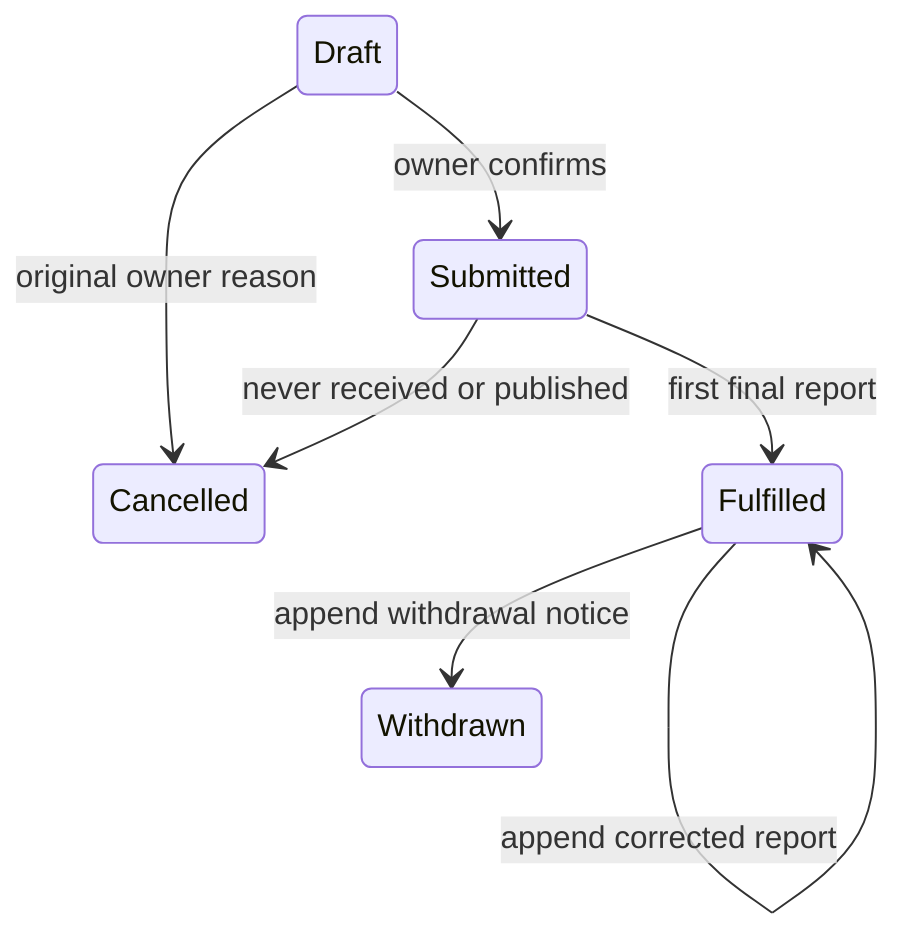

# Phase 3B-3 requirements baseline v1.0

Authoritative sources: unchanged laboratory design v0.2 (PR #16, bea741de) and this iteration's verbatim approved prompt. The prompt explicitly authorizes progression after the 3B-2 automated gate, deferring manual acceptance. No subsequent phase or merge is approved.

| ID | Implemented contract / measurable acceptance |
| --- | --- |
| LAB3-01 | A correction creates a separate draft from the current final/corrected report, retaining predecessor, order, specimen, author, reason and frozen schema. Publication appends corrected; originals and previous acknowledgements remain. One draft/successor and current version prevent branching. |
| LAB3-02 | Withdrawal preview/confirmation appends a no-measurement notice targeting current publication, retains first fulfilled_at and all history, points current publication at notice and makes order withdrawn/terminal. Active correction must be explicitly abandoned first. |
| LAB3-03 | Context-error withdraw quarantines entire chain. Only assigned active Lab Staff or active Administrator with explicit inspection permission may inspect payloads. Ordinary chart/report/history/order/audit/acknowledgement routes withhold old values/comments/unrestricted reasons. Historical report-error values remain labelled unusable history. |
| LAB3-04 | Only current responsible active Physician acknowledges the exact current publication+assignment pair. Correction, withdrawal and reassignment create fresh obligations. Notice acknowledgement never restores a usable result. UUID replay does not duplicate review/audit. |
| LAB3-05 | Active Administrator with explicit reassignment permission may replace an ineligible reviewer with an active Physician, after preview/confirmation/reason/current epoch checks. Preserve original ordering identity and reviews; no impersonation, auto-coverage or SOAP/chart expansion. |
| LAB3-06 | Pending/final/corrected/withdrawn and review/unresolved states are separate, database-derived displays. Patient and encounter summaries, bounded clinical timeline events, published longitudinal history and physician worklist provide functional navigation. |
| LAB3-07 | Original provider serialization, aggregate/child versions, context validation, command receipts, strict typed JSON and atomic audit apply to all writes. Received-ever cancellation and specimen freeze after publication persist. |
| LAB3-08 | No original DB migration. Fresh preview clones preserve old clinical rows; migrations record only explicit system-provenance initial responsibility for parent submitted/fulfilled orders, not historic physician action or acceptance. Ineligible originals remain unresolved. |

Independent specimen: pending → collected → received; collected/received → rejected before publication and without active draft. Recollection creates a new pending attempt. Rejected rows are never reset. Order completion and specimen receipt remain independent of Encounter completion.

Independent reporting: draft → final or corrected; draft → abandoned. Withdrawal is a separate immutable notice, never a mutation of a final row. Independent review is derived from current publication+assignment: not published, review required/acknowledged, withdrawal notice required/acknowledged, with an unresolved-responsibility overlay. Every new assignment epoch requires a new acknowledgement even when the same Physician returns.

No FHIR exchange, production verification, decision support, AI, prescribing, billing or external laboratory connection is introduced.
