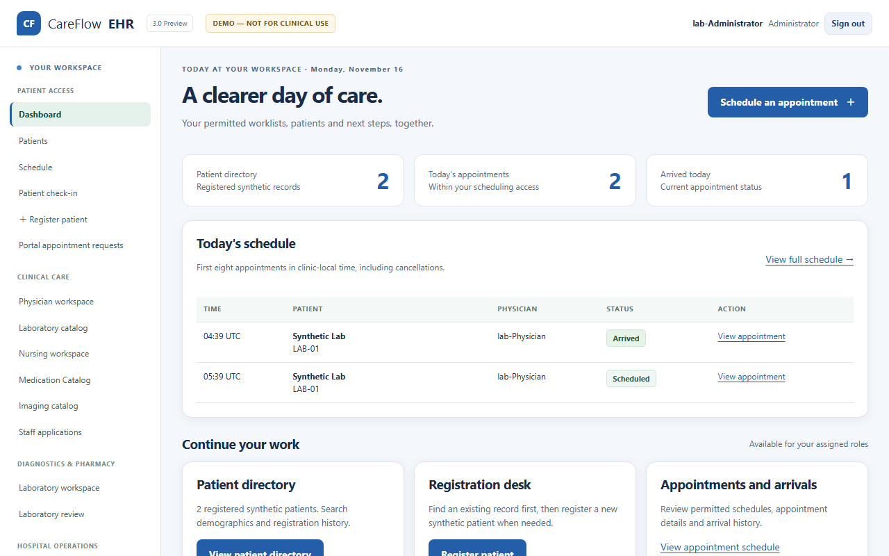
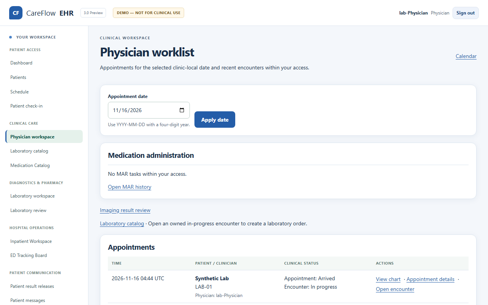
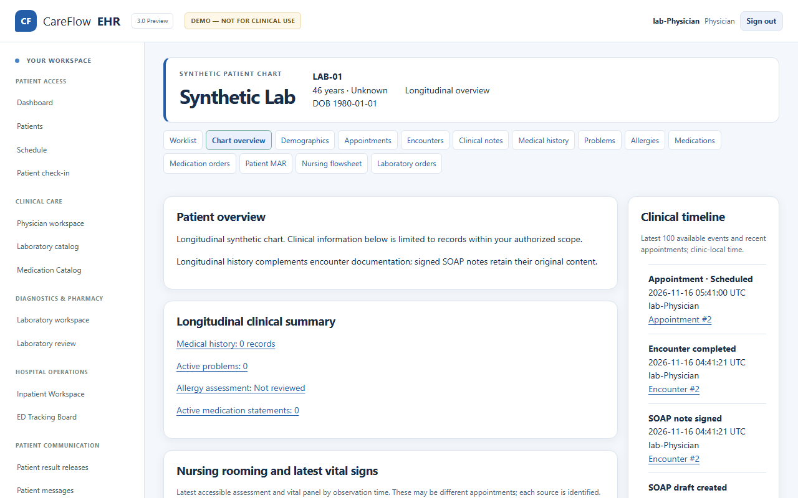
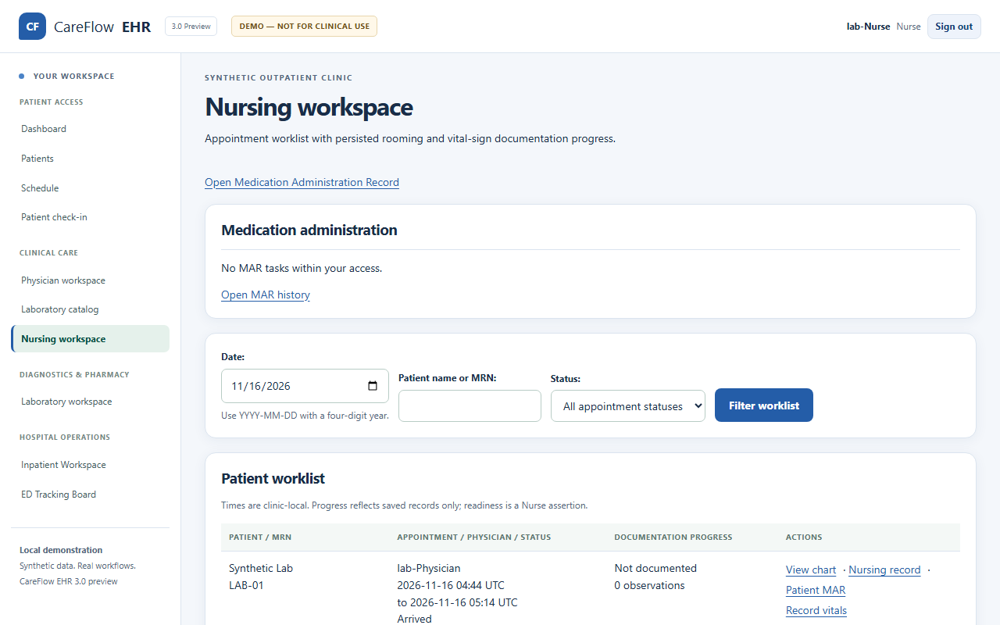
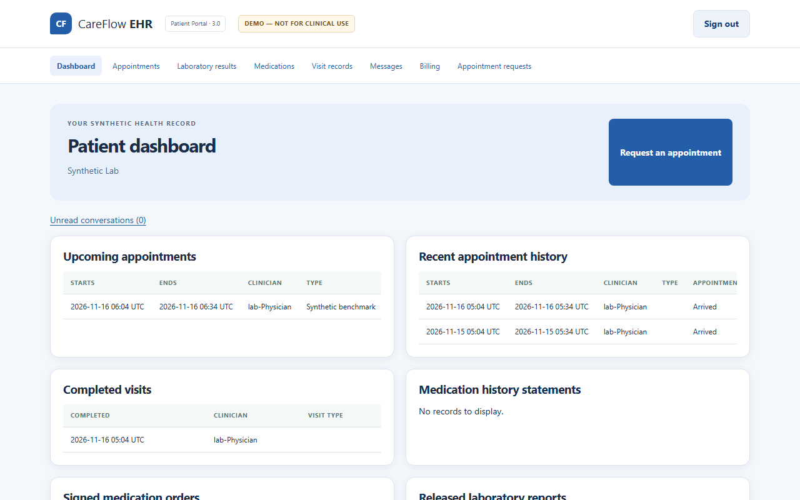

# CareFlow EHR - product gallery

Real screenshots of the v3 application. Desktop captures share a 1280-pixel presentation width and scale within GitHub's image container. No generated product mockups are used.

The homepage images show the publicly hosted website. Authenticated workspace images show fresh synthetic QA fixtures from the recorded evaluation; they do not imply that the same records or public shared credentials exist on the host. Original evidence images are reused unchanged.

## Main interface

[Hosted landing page](../v3/screenshots/landing-desktop.png) · [Mobile landing page](../v3/screenshots/landing-mobile.png)

## Physician workspace and patient chart

## Nursing workspace and Patient Portal

## Inspect the evidence

[All per-task outcomes and captures](../../testing/cua100-v1/results.md) · [CUA audit](cua-evidence-audit.md) · [Back to the project](../../../README.md)
